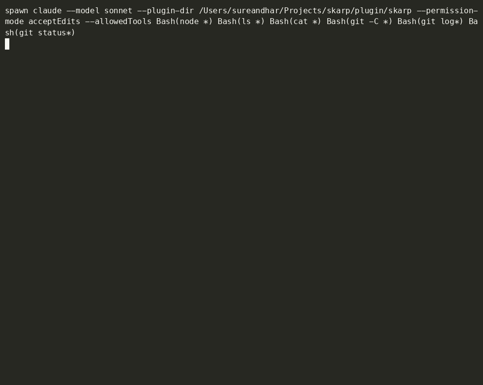

# skarp


**Use AI to write your code, and still be able to explain every line.**

*"The AI builds the code, you build the theory."*



## What it does

When you give Claude Code or GitHub Copilot a task, skarp:

1. **Asks you first.** One short question, like "Where do you think the bug is?", before the AI writes anything.
2. **Walks you through the change** and has you fill one blank, checked against the real code.
3. **Shows you what really changed**: a report with a diagram, and whether your plan matched the change.

It gets quieter once you've shown you know an area. You can always say "skip".

## Why

AI can make you faster today and weaker later. In a study of about 1,000 students, those who practised with plain ChatGPT scored 17% lower once it was taken away (Bastani et al., PNAS 2025). In a trial with 52 developers, those who used AI scored 50% on a later quiz, against 67% for those who didn't (Shen & Tamkin, Anthropic 2026).

skarp makes sure the understanding ends up in your head, not only in the code. It does this with hooks and checks in code, not with a prompt the AI might ignore.

## Good for

- **Students**: explain your own project in a presentation or interview.
- **Teachers and mentors**: let students use AI and still learn.
- **Teams**: changes made with AI that their author actually understands.

## Learn more

- [How it works](HOW-IT-WORKS.md): the seven moments, explanations and brainstorming
- [Install and troubleshooting](INSTALL.md)
- [Contributing](CONTRIBUTING.md)

Everything runs on your machine: no account, no network, and skarp never sends anything by itself. Your data lives in `~/.skarp`. To report a problem, use `/flag` or `npx skarp-copilot report`.

## Quick start

skarp is in preview. If you'd like to try it early:

**Claude Code** (CLI, desktop app or VS Code extension):

```bash
claude plugin marketplace add sureandhar-a/skarp
```

```bash
claude plugin install skarp@skarp-tools
```

**GitHub Copilot in VS Code** (experimental):

```bash
npx skarp-copilot setup
```

Then ask for something small, like `create hello.js that prints hello world`. You need Node 24.2 or newer.
Full steps, checks and troubleshooting are in **[INSTALL.md](INSTALL.md)**.

## Feedback

This is a preview, and your feedback shapes it. [Open an issue](https://github.com/sureandhar-a/skarp/issues) and tell me what you tried and what happened.

## License

[MIT](LICENSE)
